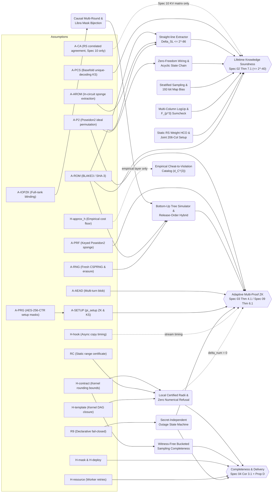

# Spec 07: Assumption Inventory, Dependency Graph & Lean 4 Correspondence (`fpn-assumptions-1.0`)

**Specification ID:** `fpn-assumptions-1.0` | **Role:** Complete 30-item inventory of cryptographic, numerical, engineering, and scope premises, theorem dependency graph, and exact mapping to the 18-module Lean 4 formalization

---

## Overview

Verifiable inference for production LLM APIs combines cryptographic commitments, floating-point kernel contracts, distributed serving invariants, and explicit API scope boundaries. Keeping the security claim rigorous requires separating premises whose failure could allow a false proof (**soundness**) from premises whose failure only prevents an honest provider from producing a proof (**completeness**) or affects residual side-channel terms (**zero knowledge**).

Three structural properties emerge from this audit:
1. **Soundness relies exclusively on cryptography and protocol compilation.** Over all 30 assumptions cataloged below (11 cryptographic, 7 numerical, 6 engineering, and 6 scope boundaries), lifetime knowledge soundness ([Spec 02](02-soundness.md) Theorem 7.1) depends solely on hash/ideal-permutation premises (`A-ROM`, `A-AROM`, `A-P2` binding, `A-PCS`, plus `A-CA` when using per-request KV matrices in [Spec 10](10-trace-commitment.md)) and protocol-level compilation obligations (`P-final`, `P-compile`, `P-loc`, `P-ext`, `P-enc`). If a GPU kernel violates its floating-point contract (`H-contract`) or a worker crashes (`H-resource`), honest proof generation fails, **never** allowing a forged or degraded model response to pass verification.
2. **Core counting, sampling, masking, and architectural reductions are machine-checked in Lean 4.** All **18 modules and 194 declarations** in [`lean/`](../lean/THEOREM.md) compile under Lean `4.29.1` + Mathlib with zero `sorry` and only Lean's three standard axioms (`propext`, `Classical.choice`, `Quot.sound`), covering the round-by-round lifetime reduction (`ProtocolBridge.fpn_protocol_lifetime_soundness`), the 16-cell sample-count table, sort-free bucketed sampling completeness (`BucketSampling.bucket_sampling_complete`), causal multi-round masking (`MaskJoint.multiround_independent_causal`), and algebraic equivalences for `MLA`, `LREC`, `PP`/`EP`, and coupled speculative decoding.
3. **Cross-specification alignment.** All ten specifications (`01`–`10`) share a single `model_id` construction ([Spec 09](09-model-commitment.md)), cubic extension challenges $\mathbb E = \mathbb F_{p^3}$, in-circuit logit recomputation, $h=3$ consumer-lineage cost accounting (`Rule CA`), and unified lookup size bounds ($\varepsilon_{\mathrm{pole}} < 2^{-138}$).

---

## 1. Complete Assumption Inventory

### 1.1 Cryptographic Premises (`C`)

| ID | Statement | Used In | Impact if Violated | Evidence |
|---|---|---|---|---|
| **`A-ROM`** | $H_{\mathrm{out}}$ (PCS Merkle trees and Fiat–Shamir challenges; instantiated with BLAKE3 or SHA-3 sharing no permutation with Poseidon2) behaves as a classical 256-bit programmable random oracle under lazy sampling. | [Spec 02](02-soundness.md) §2.2 ($\Delta_{\mathrm{SL}}$), §6–§7; [Spec 03](03-zero-knowledge.md) Thm 4.1 (`A1`); [Spec 09](09-model-commitment.md) §5.2 | Soundness and zero knowledge fail | `[Assume]` |
| **`A-AROM`** | Over the same ideal permutation $P$ as `A-P2`: (a) the in-circuit Poseidon2 gadget is an exact arithmetization of $P$; (b) every pair $(x, P(x))$ appearing in a witness extracted from an accepted proof (trace leaves/paths, HCO column trees, `model_id`, $\mathsf C_{\mathrm{cfg}}$, state anchors) was queried by the adversary to $P^{\pm 1}$ prior to the corresponding Fiat–Shamir query, up to failure probability $\Delta_{\mathrm{arom}}(Q_{\mathrm{tot}})$ (stated in the AROM framework of Chen et al., EUROCRYPT 2023). | **Soundness extraction only:** [Spec 02](02-soundness.md) §1–§2, Thm 7.1 ($\Delta = \Delta_{\mathrm{SL}} + \Delta_{\mathrm{arom}} \le 2^{-42}$); [Spec 09](09-model-commitment.md) §5.2. Unused by ZK ([Spec 03](03-zero-knowledge.md)). | Knowledge-soundness extraction fails (`R3` provides a pure-ROM fallback for trace leaves only, not static weights) | `[Assume]` (standard heuristic for in-circuit sponges) |
| **`A-P2`** | The Plonky3 Goldilocks width-12 Poseidon2 permutation (capacity $4$ elements $\approx 256$ bits) behaves as an **ideal invertible permutation** ($P^{\pm 1}$). | (i) **Binding:** collision & sponge inner-collision bounds ($p^4$ denominator, [Spec 02](02-soundness.md) §2.2); (ii) **Hiding:** salted commitments (`model_id`, $R$, $\mathsf{St}_i$, HCO columns, [Spec 03](03-zero-knowledge.md) `H2`); (iii) **PRF** (`A-PRF`). | (i) Soundness fails; (ii)/(iii) Zero knowledge fails | `[Assume]` |
| **`A-PCS`** | Zero-knowledge Basefold (Zeilberger–Chen–Fisch, CRYPTO 2024) over Reed–Solomon codes in the unique-decoding regime ($\vartheta_{\mathrm{bf}} \in \{1/4, 1/8\}$, $\delta_{\mathrm{bf}}$ below $(1-\vartheta'_{\mathrm{bf}})/2$ after blinding rate $\vartheta'_{\mathrm{bf}}$) satisfies round-by-round knowledge soundness: fold escape $\le n_j / |\mathbb E|$ and $s$-query escape $\le (1-\delta_{\mathrm{bf}})^s$ ($0.645^{168} \le 2^{-106}$). | [Spec 02](02-soundness.md) §6.2, §6.4, Thm 7.1 (`P-rbr`) | Soundness budget invalidated | `[Assume]`; query escape arithmetic `[Lean: ProtocolBridge.basefold_qry_esc_le]` |
| **`A-CA`** | Reed–Solomon interleaved correlated agreement in the unique-decoding regime (Ben-Sasson et al., FOCS 2020, Thms 1.6 & 6.1) holds under adaptive ROM round-by-round extraction. | **Used only by [Spec 10](10-trace-commitment.md) (`TC`)** for per-request KV matrix proximity ($\tau_{\mathrm{prox}}$). Not needed by [Spec 09](09-model-commitment.md) $\pi_{\mathrm{setup}}$, which commits message rows directly before drawing shared columns. | `TC` KV proximity fails if `TC` is enabled; static weight commitment unaffected | `[Assume]` |
| **`A-PRF`** | Keyed Poseidon2 sponge (truncated duplex/sponge over $P$) is a multi-key PRF with advantage $\mathsf{Adv}^{\mathrm{PRF}} \lesssim (q_F + q_P)^2 / 2^{256} + \mu q_P / 2^{256}$ (Andreeva et al., FSE 2015; Mennink et al., ASIACRYPT 2015; Daemen et al., ASIACRYPT 2017). | **Zero knowledge only:** [Spec 03](03-zero-knowledge.md) Thm 4.1 (`H4`), Lemma 5.1. Soundness never relies on PRF secrecy ([Spec 02](02-soundness.md) §9). | Sampling-noise indistinguishability degrades; soundness unaffected | `[Assume]` |
| **`A-AEAD`** | The authenticated encryption scheme wrapping multi-turn `blob` state is IND\$-CPA secure with fixed-length padding. | [Spec 03](03-zero-knowledge.md) Thm 4.1 (`A6`, `H2`) | Encrypted multi-turn history privacy degrades; soundness unaffected | `[Assume]` |
| **`A-IOPZK`** | For every public input and challenge tuple, the honest-verifier IOP view is uniform over a non-empty affine subspace (full-rank masks with positive remaining budget). | [Spec 03](03-zero-knowledge.md) Thm 4.1 (`A3`, `H1`); [Spec 09](09-model-commitment.md) Thm 6.1 | Zero knowledge fails | Single-proof & causal cores `[Lean: Mask, MaskJoint]`; specialization `[Paper]` |
| **`A-SETUP`** | The one-time setup proof $\pi_{\mathrm{setup}}$ (and configuration-update proof $\pi'_{\mathrm{setup}}$) is knowledge-sound and zero-knowledge (simulation error $\delta_{\mathrm{setup}}$) inside a fixed-size container. | [Spec 03](03-zero-knowledge.md) (`A6`, `H2`); [Spec 09](09-model-commitment.md) §5.2, Thm 6.1 | Model-level weight extraction or update-type hiding fails | `[Assume]` + `[Paper]` (direct $0.7^{206}$ joint column bound) |
| **`A-PRG`** | AES-256-CTR under independent ephemeral per-block keys $K_b$ (erased immediately after proving) is computationally indistinguishable from uniform random streams. | **Setup ZK only:** [Spec 09](09-model-commitment.md) §6 ($\delta_{\mathrm{setup}} \le \delta_{\mathrm{setup}}^{\mathrm{stat}} + B_{\mathrm{setup}}\mathsf{Adv}^{\mathrm{PRG}}$) for two-pass mask regeneration. Per-reply proofs use fresh CSPRNG randomness. | Setup proof degrades from computational ZK; soundness and per-reply statistical masking unaffected | `[Assume]` |
| **`A-RNG`** | All salts, blinding rows, server nonces $N_s$, keys $K_{\mathrm{prf}}$, and anchor randomness $r_i$ come from a fresh CSPRNG; prover masks are erased upon proof release and never reused across VM snapshots. | [Spec 03](03-zero-knowledge.md) (`A4`), Lemma 4.2, §5.1; [Spec 04](04-completeness.md) `R10` | Mask reuse across two proofs allows linear subtraction recovery | `[Assume]` (operational) |

*Explicitly not assumed:* Quantum random-oracle (`QROM`) security; trust in the API provider, GPUs, or chip vendors; proof-of-work or economic cost assumptions; or PRF secrecy for soundness.

---

### 1.2 Numerical & Serving-Configuration Premises (`N`)

| ID | Statement | Used In | Impact if Violated | Evidence |
|---|---|---|---|---|
| **`H-contract`** | Every deployed kernel on `(hardware, library, config)` satisfies the per-operator rounding contract $\mathcal C \preceq \mathcal C_{\max}$ committed in `model_id` over its domain $D_o$ (e.g., `fp32` cuBLAS reductions in tier `R32`). | [Spec 04](04-completeness.md) Thm 3, Cor 3.1 ($\varepsilon_{\mathrm{num}}=0$); [Spec 05](05-computation-model.md) Thm 3.2; [Spec 06](06-tolerance-and-cheats.md) Thms 6.4 & 6.8; [Spec 03](03-zero-knowledge.md) ($\delta_{\mathrm{num}}=0$) | **Completeness and $\delta_{\mathrm{num}}$ only; soundness unaffected.** Live numerical failures must trigger configuration withdrawal/update (`R13`), never silent per-request drops. | `[Assume]`; `[Meas]` **0 / 392,928** bad blocks on `Qwen3-0.6B` & `Llama-3.2-1B` (`fp32` reduce), falsified at $39\times$ under default `bf16` split-K |
| **`RC` (Range Certificate)** | At `model_id` publication, an input-independent weight interval table $\mathsf{RC}_M$ verifies $\mathsf{infl}\cdot B < F_{\max}$ for every port and internal intermediate (partial sums, squares, exponentials, recurrent states) and no modular wrap-around in $\mathbb F_p$. | [Spec 04](04-completeness.md) Lemma 1.1$'$; [Spec 05](05-computation-model.md) Prop 2.1; [Spec 06](06-tolerance-and-cheats.md) §2.1 | Overflow or modular wrap-around could cause honest proving failure; soundness unaffected | Checkable static condition `[Paper]`; modular lift uniqueness `[Lean: BoundedLift]` |
| **`H-template`** | Every active slot executes a physical kernel belonging to a declared implementation template family $\mathfrak T(\nu)$ whose error-closure lemma holds. | [Spec 05](05-computation-model.md) Thm 3.2, §3.4; [Spec 04](04-completeness.md) Cor 3.1 | Uncovered kernel optimizations cause honest proof rejection; soundness unaffected | `[Def]` + `[Paper]` (`Scan` template for `LREC` remains `[Open]`) |
| **`H-mask`** | The serving engine applies constrained-decoding token masks bit-identically to the committed deterministic compiler $\mathsf{MaskCompile}_M$ ([Spec 05](05-computation-model.md) §4.2 `C6`). | Completeness on structured-output / tool requests | Honest constrained replies rejected; soundness unaffected | `[Assume]` (differential-testable) |
| **`H-deploy`** | Serving invariants: dropless MoE routing, coupled speculative verification, recurrent-state rollback on rejected draft chunks, declared `KVCast` nodes on lossy P/D links, and `fp32` LM-head logits. | [Spec 05](05-computation-model.md) §2.3, §3.4–§3.5; [Spec 06](06-tolerance-and-cheats.md) §1.2, §3.3 | Honest completeness failure or wider sampling manipulation band | `[Def]` |
| **`H-approx_h`** | Any cheating execution costs at least $\sum_a c_a(1 - s_{\tau(a)})\mathbf 1[V_a = 0]$ under lineage depth $h$. | **Empirical cheat catalog only** ([Spec 06](06-tolerance-and-cheats.md) Thm 6.5$'$); feeds **no** cryptographic soundness theorem or Lean proof | Maps compute saved $s$ to bad-cost fraction $d_C^{(h)}$ | `[Assume]` (empirical; bounded for finite $h$ by `S4`) |
| **`S_tol` Bound** | The published per-context-tier sparse-attention bound $S_{\mathrm{tol}}(T)$ upper-bounds undetectable sub-rounding tail dropping on `model_id`. | [Spec 06](06-tolerance-and-cheats.md) §5.4 | Empirical savings disclosure accuracy | `[Meas]` oracle upper bounds on `Qwen3-4B` (4k–32k) |

---

### 1.3 Engineering & Operational Premises (`E`)

| ID | Statement | Used In | Impact if Violated | Evidence |
|---|---|---|---|---|
| **`H-resource`** | Admission reserves proof capacity, fixed-shape proving finishes within $\Delta_{\mathrm{rel}}$, boundary traces persist across replicas before stream end, and $J$ stateless worker retries fail independently at rate $\le \phi$. | [Spec 04](04-completeness.md) Prop D ($\varepsilon_{\mathrm{del}} \le \phi^J$) | On-time proof delivery degrades; soundness and ZK unaffected when `R9` holds | `[Assume]` |
| **`R9` (Declarative Fail-Closed)** | Unrecoverable **resource** faults (secret-independent crashes/timeouts) publish a partition-wide outage window $\mathcal O$ rather than failing isolated requests (`R1`–`R13`; numerical faults follow `R13`). | [Spec 04](04-completeness.md) Thm 4, Lemma 6; [Spec 03](03-zero-knowledge.md) (`H3`, $\delta_{\mathrm{flt}}=0$) | Residual failure-channel leakage $\delta_{\mathrm{flt}} > 0$ | `[Def]` |
| **`H-hook`** | Online read-only boundary recording adds stream-event latency determined solely by $(\mathcal L_i, \mathrm{Prof}, \text{fresh randomness})$ (e.g., asynchronous host copy with reserved bandwidth, [Spec 10](10-trace-commitment.md) §3.2). | [Spec 03](03-zero-knowledge.md) §3.3, §4.7 (token-arrival timing ZK) | Without `H-hook`, Theorem 4.1 covers transcript bytes and proof-release deadlines rather than inter-token arrival jitter | `[Assume]` (`[Open]` for empirical timing) |
| **`H-publish`** | The client retrieves `model_id` from the provider's canonical public release endpoint. | [Spec 01](01-relation.md) §1; [Spec 08](08-related-work.md) §2.1 | External trust anchor identifying which commitment represents the advertised flagship service | `[Assume]` (non-cryptographic anchor) |
| **`H-client-state`** | Multi-turn clients store and supply their latest verified anchor $\mathsf{St}_{i-1}$ and fresh $N_c$. | [Spec 01](01-relation.md) §6.4; [Spec 05](05-computation-model.md) Prop 4.1 | Stateless clients verify consistency relative to the supplied anchor rather than full session history | `[Def]` |
| **`H-api-auth`** | The API authenticates tenant identity in `aad` before decrypting `blob`. | [Spec 01](01-relation.md) §6.4 | Defense-in-depth for `blob` confidentiality (cross-tenant splicing is already rejected in-circuit by session/hash checks) | `[Assume]` |

---

### 1.4 Explicit Out-of-Scope Boundaries (`S`)

| ID | Boundary | Protocol Handling |
|---|---|---|
| **`S1`** | Post-compute small-fraction token tampering ($<\rho$) or server-nonce grinding / within-band tie selection | Manipulation band $\bar\delta(T)$ published per `model_id` ([Spec 06](06-tolerance-and-cheats.md) §3.3); optional pre-committed `nonce-ticket` mode ([Spec 01](01-relation.md) §5.5) |
| **`S2`** | Strategic CoT shortening learned by the committed weights/prompt themselves | Outside inference verification (the committed model genuinely produced the shorter CoT) |
| **`S3`** | Ground-truth factual accuracy of external tool return payloads | Tool outputs enter as committed boundary witnesses ([Spec 01](01-relation.md) §3) |
| **`S4`** | Proof-system-aware exotic degenerate-input attacks (causal prefix collapse above layer $\ell_0$) | Mitigated up to depth $h=3$ by `Rule CA` ([Spec 06](06-tolerance-and-cheats.md) Prop 6.6) without paying $\Theta(L)$ full-prefix opening cost |
| **`S5`** | Sub-rounding sparse-attention tail dropping | Bounded by oracle measurements, halved via default scalar `LSE` observation (`M1`), and published as $S_{\mathrm{tol}}(T)$ per `model_id` |
| **`S6`** | Version-1 excluded API features (`logprobs`, user-supplied custom sampling code, auxiliary summarizer/classifier models, `QROM`, `LREC` float completeness pending `Scan`) | Rejected deterministically by public predicate $\Phi_{\mathrm{pre}}$ (zero leakage) or committed under a separate `model_id` |

---

### 1.5 Protocol-Level Compilation Obligations (`P`)

| ID | Obligation | Status |
|---|---|---|
| **`P-final`** | Verifier deterministically rejects every doomed complete transcript at final check | `[Paper]`; abstract interface mechanized in `ProtocolBridge.ProtocolRBRSpec` |
| **`P-compile`** | Extracted witness columns satisfy the flat constraint system iff the protocol relation holds, and each reduction preserves doomed states outside its escape set | Sampling boundary-pair iff `[Lean: BucketSampling.boundary_pair_sound_complete]`; abstract bridge `[Lean: ProtocolBridge.compiled_cs_doomed_of_bad_sample]`; concrete circuit builder `[Open]` |
| **`P-loc`** | Sampled lineage atom indicator $V_a$ and step check $S_t$ depend solely on global columns and the lineage objects opened in-circuit | `[Paper]` by construction ([Spec 01](01-relation.md) §4.5); lineage monotonicity `[Lean: ProtocolBridge.atomBad_of_mem_lineage]` |
| **`P-rbr`** | Every Fiat–Shamir round escape probability is bounded by $\varepsilon_\tau \le \bar\varepsilon_{\mathrm{rbr}}$ | Sampling, multi-column LogUp, $\mathbb F_{p^3}$ Sumcheck, HCO/$\pi_{\mathrm{setup}}$/TC/Basefold query bounds `[Lean]`; remaining Schwartz–Zippel rounds `[Paper]` + `A-PCS` |
| **`P-ext`** | Straight-line extractor $\mathcal E_{\mathrm{SL}}$ is prefix-preserving outside collisions `B1`–`B3` with $\Delta_{\mathrm{SL}} \le (\alpha+2)Q_{\mathrm{tot}}^2 / p^4 \le 2^{-86}$ | Collision reduction `[Paper]`; exact $p^4$ arithmetic `[Lean: ProtocolBridge.delta_SL_p4_default]` |
| **`P-enc`** | Pre-challenge slot-table unrolling uniqueness, port wiring uniqueness, and wrap-around-free integer reference determinism | Operator/trace/lift uniqueness `[Lean: StdAlg, StdAlgOps, ArchGeneral, BoundedLift]`; global slot-table constraints `[Paper]` |

---

## 2. Theorem Dependency Graph

Solid arrows denote premises entering a theorem; dashed arrows denote terms affecting only residual advantage bounds or the empirical cheat catalog.

---

## 3. Correspondence with the Lean 4 Formalization (`18 Modules, 194 Declarations`)

Every module listed below is verified by `lean/check.sh` on Lean `4.29.1` + Mathlib with **zero `sorry`** and **only standard axioms**. The right-hand column states the exact boundary between the mechanized theorem and the full protocol specification.

### 3.1 Lifetime Knowledge Soundness ([Spec 02](02-soundness.md), [Spec 09](09-model-commitment.md), [Spec 10](10-trace-commitment.md))

| Specification Claim | Lean 4 Declarations (`FlashProveNext.*`) | Exact Scope & Remaining Paper Boundary |
|---|---|---|
| **Theorem 7.1:** End-to-end round-by-round lifetime soundness ($\Pr[\mathsf{BadAccept}] \le 2^{-40}$ at $Q \le 2^{64}$) | `RoundByRound.rbr_lifetime_soundness`, `rbr_lifetime_soundness_sum`, `rbr_default_lifetime`; `ProtocolBridge.hpath_of_protocol_spec`, `compiled_cs_doomed_of_bad_sample`, `fpn_protocol_lifetime_soundness` | `hpath` is derived in Lean from `ProtocolRBRSpec` (`P-ext`, `P-compile`, `P-loc` over `AtomBad`, `P-final`); concrete circuit-builder compilation to `CompiledCS` and `A-PCS` fold soundness remain on paper. |
| **Sample-count formula & 16-cell table** ($k = \lceil\ln(Q/\varepsilon_{\mathrm{sp}})/(-\ln(1-s))\rceil$, $3\times 105 = 315$, $k=104$ fails) | `LifetimeSoundness.kSuff_iff_kReq_le`, `kReq_eq`, `table_Q30_e20`, `table_Q30_e40`, `table_Q64_e20`, `table_Q64_e40`, `k105_sufficient`, `k104_insufficient`; `RoundByRound.three_pool_default`, `k104_fails_rbr`, `default_budget_rbr` | Exact (zero gap). |
| **Stratified sampling & 192-bit mapping bias** ($a_{\mathrm{map}} \le 2^{-107}$) | `SpotCheck.cost_weighted_bound`; `LifetimeSoundness.bucketCount_bounds`, `bucket_prob_close`, `pool_map_le`, `two_pool_map_le_max`; `RoundByRound.multi_pool_map_le`, `amap_default` | Exact for finite pools with empty-stratum bypass; multi-limb division gadget constraints fall under `P-compile`. |
| **Multi-column LogUp soundness** ($(n_t(w-1)+n_v+n_t)/|\mathbb E|$) | `LogUp.logup_bad_card_le`, `mergedZeroSum_iff`; `RoundByRound.multicol_badgamma_card_le`, `logup_multicol_card_le`, `logup_multicol_prob` | Exact for injective tables with $n_v < \operatorname{char}\mathbb F$. |
| **Sumcheck soundness & $\mathbb F_{p^3}$ degree / query bounds** | `Sumcheck.agree_card_le`, `sumcheck_bad_challenges`; `SumcheckSound.sumcheck_sound_real`; `RoundByRound.field_p2_iff`, `field_p3_bits`, `slot_table_numerator`, `fold_p3_bits`; `ProtocolBridge.sumcheck_round_esc_le`, `hco_col_esc_le`, `setup_col_esc_le`, `tc_col_esc_le`, `basefold_qry_esc_le` | Proves $\mathbb F_{p^2}$ fails above $D = 2^{22}-1$, $\mathbb F_{p^3}$ covers $D \le 2^{85}$, and verifies $0.55^{123}, 0.7^{206}, 0.76^{268}, 0.645^{168} \le 2^{-106}$. |
| **Straight-line extraction $p^4$ bound** ($\Delta_{\mathrm{SL}} \le 2^{-86}$) | `ProtocolBridge.goldilocks_p4_bounds`, `delta_SL_p4_default` | Exact $p^4$ arithmetic in Lean;sponge call reduction `B1`–`B3` on paper. |

### 3.2 Zero Knowledge ([Spec 03](03-zero-knowledge.md), [Spec 09](09-model-commitment.md))

| Specification Claim | Lean 4 Declarations (`FlashProveNext.*`) | Exact Scope & Remaining Paper Boundary |
|---|---|---|
| **Single-proof linear & Vandermonde blinding** | `Mask.fiber_card_eq`, `masked_view_independent`, `vandermonde_surjective`, `block_surjective`; `MaskJoint.fiber_card_mul` | Exact over any finite abelian group / field. |
| **Shared-row RS + MLE surjectivity & Basefold fold masking** (`T1`, `T3`, `T4`) | `MaskJoint.joint_disjoint_surjective`, `joint_surjective_of_det`, `joint_tensor_surjective`, `fold_mask_independent`, `postprocess_independent` | Algebraic surjectivity in Lean; non-zero determinant probability over $\mathbb F_{p^3}$ via Schwartz–Zippel on paper. |
| **Libra sumcheck mask bijection** (`T2`) | `MaskJoint.libraG_eq_cubeSum`, `libra_mask_bijective`, `libra_transcript_independent`, `libra_const_unique`, `libra_mask_bijOn_hyperplane` | Exact bijection onto the round-sum consistency hyperplane. |
| **Causal multi-round transcript uniformity** ([Spec 03](03-zero-knowledge.md) §4.3) | `MaskJoint.evalTranscript_spec`, `causal_transcript_existsUnique`, `multiround_independent_causal` | Proves unique transcript existence and exact uniform pushforward for prefix-measurable witness shifts; multi-proof ROM programming & PRF hybrids on paper. |

### 3.3 Completeness, Sampling & Production Architectures ([Spec 04](04-completeness.md), [Spec 05](05-computation-model.md), [Spec 06](06-tolerance-and-cheats.md))

| Specification Claim | Lean 4 Declarations (`FlashProveNext.*`) | Exact Scope & Remaining Paper Boundary |
|---|---|---|
| **Reference determinism, operator uniqueness & modular lifts** | `StdAlg.trace_exists`, `trace_unique`, `round_unique`, `verdict_determined`; `StdAlgOps.divmod_unique`, `round_div_unique`, `pwRel_existsUnique`, `l2_rel_int`, `intCast_inj_small`, `topK_exists`, `topK_unique`; `Gadgets.sat_existsUnique`; `ArchGeneral.sbfp_shift_unique`; `BoundedLift.signedLift_unique_of_bounded`, `inner_prod_abs_le`, `ffn_per_slot_product_lt`; `LogUp.pole_card_le`, `logup_complete` | Exact integer/modular uniqueness and LogUp pole counts; real-valued floating-point rounding propagation (`Dot`, `RMSNorm`, `AttnFA`) proved on paper and calibrated across 392,928 GPU blocks. |
| **Sort-free bucketed sampling (`fpn-samp-bk-v3`)** (Lemmas 6.7a / 6.7$'$ / 6.7$''$, circuit iff, Theorem 6.8) | `BucketSampling.nucleus_iff_per_token`, `argmax_mem_nucleus`, `nucleus_sandwich`, `sure_mono_j`, `poss_mono_j`, `prefix_boundary_exists`, `boundary_pair_sound_complete`, `invCDF_exists`, `bucket_sampling_complete` | Complete integer nucleus sandwich, $j$-monotonicity, zero-slack boundary-pair circuit characterization, and relaxed inverse-CDF completeness mechanized in Lean; step-1 `binary64` index quantization covered by `H-contract`. |
| **Componentwise pairwise MoE routing** ([Spec 06](06-tolerance-and-cheats.md) §3.6) | `Gadgets.approxTopK_pairwise`, `approxTopK_pairwise_of_topK`, `pairwiseApproxTopK_tighter`, `pairwiseApproxTopK_sum`, `approxTopK_sound` | Exact completeness and envelope score bounds under $|s_e - \hat s_e| \le r_e$. |
| **Coupled speculative decoding, MLA, chunked `LREC` & `PP`/`EP`** | `Speculative.specLoop_eq_seqGen`; `ArchGeneral.mla_score_absorbed_eq`, `mla_out_absorbed_eq`, `pp_rangeLayers_add`, `ep_allreduce_eq_moe`; `LinearAttn.chunkRun_eq_recRun`, `lrec_state_unique`, `lrec_exists_bad_of_mismatch`, `lrec_state_bytes_bound`, `lrec_spotcheck_bound` | Exact ring/state equivalences mechanized in Lean; floating-point parallel scan template `Scan` for `LREC` remains `[Open]`. |
